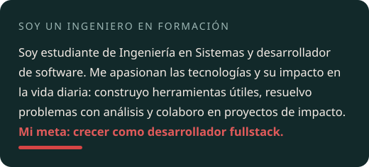
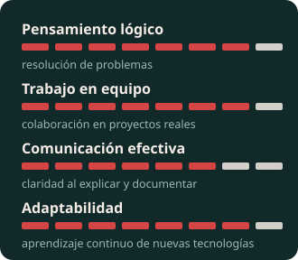
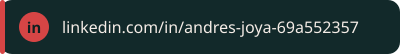
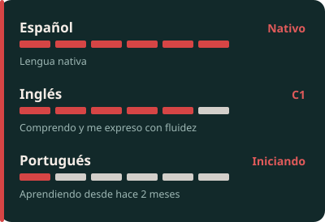
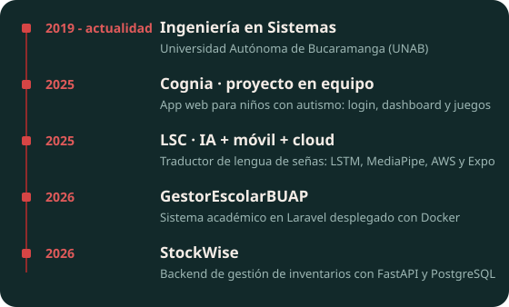
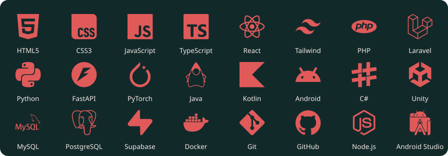
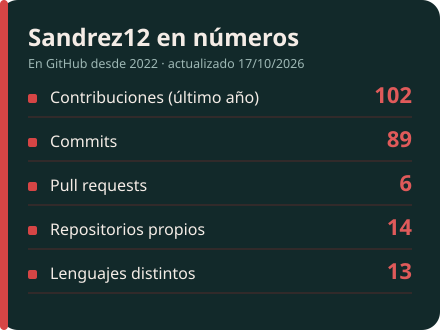

 

<table align="center">
  <tr>
    <td valign="middle"></td>
    <td valign="middle"></td>
    <td valign="middle"></td>
  </tr>
</table>

<table align="center">
  <tr>
    <td valign="top">
       
       
       
      
       
    </td>
    <td valign="top"></td>
  </tr>
</table>

 

| Proyecto | Descripción | Stack |
|---|---|---|
| [**LSC**](https://github.com/Sandrez12/LSC) | Reconocimiento de lengua de señas colombiana: modelo LSTM entrenado sobre puntos de MediaPipe, API en AWS y app móvil. | Python, PyTorch, MediaPipe, React Native, AWS |
| [**GestorEscolarBUAP**](https://github.com/Sandrez12/GestorEscolarBUAP) | Gestor académico para profesores y estudiantes: materias, grupos, inscripciones y autenticación. Desplegado con Docker. | Laravel, PHP, PostgreSQL, Docker |
| [**Cognia**](https://github.com/zquintero246/Cognia) | Aplicación web modular para estimular habilidades cognitivas y sociales en niños y jóvenes con autismo. Proyecto en equipo; mi aporte fue el login, el dashboard y los módulos de juegos. | JavaScript, Python |
| [**MoodJournal**](https://github.com/Sandrez12/MoodJournal) | Diario emocional con análisis de sentimiento de cada entrada, estadísticas y rachas. | React, TypeScript, Supabase, Tailwind |
| [**StockWise**](https://github.com/Sandrez12/StockWise) | Backend para gestionar inventarios (en desarrollo). | FastAPI, PostgreSQL, Docker |
| [**Algoritmo genético de portafolio**](https://github.com/Sandrez12/Algoritmo-gen-tico-aplicado-a-un-portafolio-de-inversi-n) | Optimización de un portafolio de inversión con algoritmos genéticos y visualización de generaciones. | Python |

 

<table align="center">
  <tr>
    <td></td>
    <td></td>
  </tr>
</table>

  <picture>
    <source media="(prefers-color-scheme: dark)" srcset="https://raw.githubusercontent.com/Sandrez12/Sandrez12/output/github-snake-dark.svg">
    <source media="(prefers-color-scheme: light)" srcset="https://raw.githubusercontent.com/Sandrez12/Sandrez12/output/github-snake.svg">
    
  </picture>

 

  
    
  

